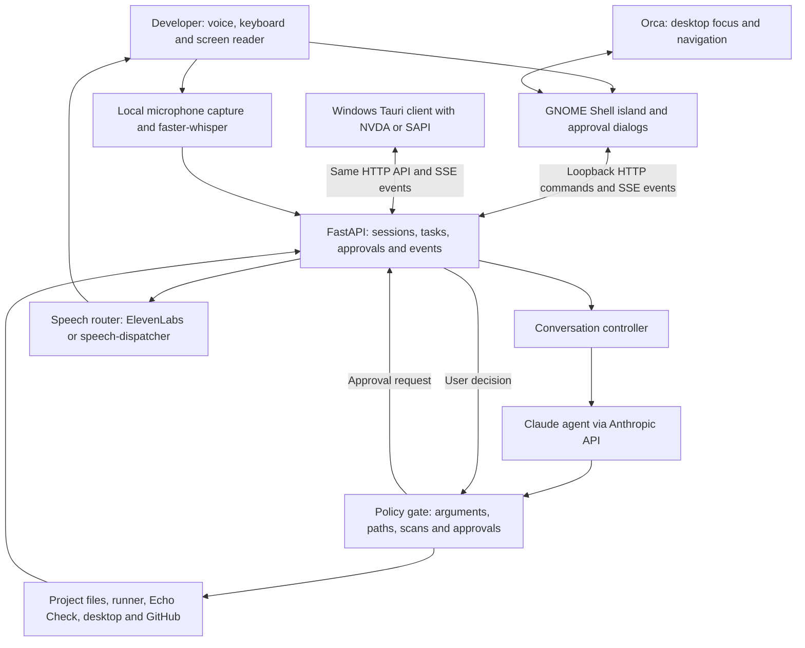

# Artemis architecture

Artemis is a voice-first coding companion for blind developers. Its primary development and demo
target is **Ubuntu 24.04 + GNOME 46, with Orca as the primary screen reader**. The team switched
from Windows halfway through the hackathon because Ubuntu made coordination between the desktop,
screen reader, Artemis and speech services easier. The Windows Tauri client and NVDA/SAPI support
remain in the repository and continue to receive CI coverage.

This describes the current runtime rather than the kickoff build plan. Message shapes live in
[contracts.md](contracts.md), historical choices in [decisions.md](decisions.md), and launch
instructions in [infra/README.md](../infra/README.md).

## Runtime shape

The core runs as one Python process. Modules use Python interfaces internally; clients use HTTP
commands and server-sent events (SSE). The server does not depend on Tauri or GNOME Shell.

| Module | Responsibility |
|---|---|
| `server/artemis/core/` | API, sessions, task lifecycle, approvals, cancellation and events |
| `server/artemis/contracts/` | Pydantic models defining API and event messages |
| `server/artemis/voice/` | Microphone, transcription, wake word, speech routing and audio cues |
| `server/artemis/conversation/` | Built-in phrases, eligible voice approvals, preferences and follow-ups |
| `server/artemis/agent/` | Claude tool loop, context, plans and explanations |
| `server/artemis/policy/` | Tool validation, paths, scans, approvals, desktop actions and publishing |
| `server/artemis/runner/` | Project files and limited program execution |
| `server/artemis/echo/` | Playwright accessibility snapshots and axe-core checks |
| `client/prototypes/water-desktop/` | Connected GNOME extension, island and approval dialogs |
| `client/` | Retained Tauri 2, React and TypeScript client for Windows |

## Local connection and startup

`infra/start.sh` starts the core on a free `127.0.0.1` port with a fresh launch token. It writes
the URL, token and PID to `$XDG_RUNTIME_DIR/artemis/launch.json`, or
`/tmp/artemis-$UID/launch.json` without the runtime directory. The directory is mode `0700`,
the file is `0600`, and the file is removed when the launcher exits. It contains no API key.
Install and enable the extension separately; it discovers the core through this file.

HTTP access requires the launch token and is subject to origin checks. Ordered SSE events have
sequence IDs for replay and deduplication. The island's activity comes from core events rather
than simulated progress. Projects default to `~/ArtemisProjects/<project>/`, configurable with
`ARTEMIS_PROJECTS_DIR`. The root can be symlinked; links inside projects are restricted by policy.

## Request flow

1. The developer types, uses push-to-talk, or uses the opt-in wake word. Audio capture and
   faster-whisper transcription happen locally.
2. With conversation mode enabled, the controller handles built-in phrases, follow-ups and
   approval words. Coding requests proceed to the agent through the session.
3. Claude plans work and proposes registered tool calls. Every call passes through the policy
   gate; the agent does not directly authorize its own actions.
4. For writes and edits, the gate validates paths, constructs the change, scans Python content
   with Bandit and requests approval. Events and speech expose the summary and findings.
5. Approval binds to the proposal and relevant file contents. Changed files or proposals invalidate
   the decision. Rejection leaves the proposed write or run unexecuted.
6. Approved runs execute through the runner. Events return actual status and captured output;
   speech includes the exit code and final output/error line.
7. Further edits, inspections and publishing follow their own policy and approval requirements.

## Approval model

| Action | Decision behavior |
|---|---|
| Project writes, edits and runs | Approval required; eligible actions also support voice approval in conversation mode |
| Voice approval | Non-blocking `write_files` and `run_program` only; exact approval phrase and a 1.5-second guard after the summary finishes |
| Voice rejection | Can reject an open approval; casual “yes” and “no” do not decide approvals |
| Flagged actions | Keyboard decision with the dialog's explicit override |
| Desktop outside reads, commands, typing and key presses | Keyboard approval under desktop policy |
| Ordinary apps, paths and HTTP(S) URLs | Policy-checked; allowed opens can proceed without a dialog; dangerous opens require approval or are rejected |
| GitHub publishing | Keyboard approval covering repository, visibility, description and files; public publishing requires an override |
| Read-only project inspection and scanning | Policy-checked without a write/run approval |

Keyboard decisions operate on the focused dialog control. Escape rejects; repeating keys do not
approve. High-severity approvals start on Reject and require Shift+Enter on Approve to override.
Voice decisions use the same approval ID and hash resolution as client decisions.

Files, webpage content and tool results are treated as untrusted input. This is a defense, not a
guarantee that prompt injection cannot influence the model. Authorization is enforced separately.

## Voice, Orca and speech coordination

**Orca is the primary screen-reader target.** It handles accessible desktop navigation and focus;
Artemis speaks its own progress, approvals and results. Speech output does not replace accessible
controls or screen-reader testing.

On Linux, optional ElevenLabs speech has a local speech-dispatcher fallback. Artemis connects
directly using SSIP; cancellation targets its own messages rather than every client's speech.
BEGIN/END events track Artemis's playback. High-priority messages can interrupt Orca, normal
messages can interrupt or be interrupted, and low-priority notifications can be dropped. This
does not provide a complete view of Orca's speech activity or guarantee that voices never overlap.

Windows retains NVDA/SAPI support and optional ElevenLabs output. Artemis does not change the
screen reader's own voice or rate.

Push-to-talk remains available alongside wake mode. `ARTEMIS_BARGE_IN=on` (the default) enables
interruption with the wake phrase or supported stop words, with checks against Artemis's own
spoken line. Setting it to `off` drops microphone input during Artemis's speech. Real-room testing
remains necessary, especially with a screen reader playing through speakers. Whisper priming at
startup reduces first-request model initialization delays.

## Execution, desktop actions and publishing

`run_program` selects an argv preset and runs without a shell, using a separate interpreter,
scrubbed environment, timeout, output limits and process-tree cleanup. This is gated and limited
execution, **not an OS sandbox**. Static scanning does not prove code safe.

Linux desktop tools are separate capabilities: open apps, files and URLs, read approved outside
files, type text or keys, and execute an explicitly approved command. `run_command` can use a
shell; it does not have `run_program`'s no-shell restriction. Desktop actions depend on the target
application and current focus.

`publish_github` requires an authenticated local GitHub CLI session. It snapshots eligible project
files into a separate temporary directory, excludes `.git`, `.env` and ignored files, and checks
for likely secrets before approval. The hash covers destination, visibility, description and file
names/bytes; a fresh snapshot is checked after the decision. Publishing creates a new repository
from the snapshot rather than pushing existing history or hooks. Secret detection reduces risk
but does not guarantee that all sensitive content is detected.

## Echo Check

Echo Check inspects local project pages using Playwright accessibility snapshots and bundled
axe-core rules. Reports include roles, names, structure, findings and checks needing human review.
It provides evidence before and after changes, not a complete accessibility certification or a
substitute for testing with Orca and blind developers.

## Data boundaries

- **Microphone audio:** transcribed locally with faster-whisper.
- **Claude:** requests and relevant project/tool context go to the Anthropic API.
- **ElevenLabs, when enabled:** spoken text goes to the service after secret redaction. This can
  include request transcripts, filenames, errors and answers even though microphone audio stays local.
- **GitHub:** approved files leave the machine when publishing is accepted.
- **Secrets:** redaction and child-environment filtering are tested defenses, not blanket guarantees.

## Validation and remaining work

CI covers server tests on Ubuntu and Windows, client unit tests/build, browser tests and secret
scanning. Platform results overlap. Skips, optional dependencies and excluded live tests mean a
green run does not exercise every audio, browser or live integration. See the
[workflow](../.github/workflows/ci.yml) and [CI runs](https://github.com/BU-Hackathonz/Artemis/actions).

Ubuntu/Orca is the priority. Hardware validation, speech coordination and testing with blind
developers outside the team remain ongoing work. Installers, setup guidance and realistic workflow
testing are next steps; automated reliability checks do not establish usability.
